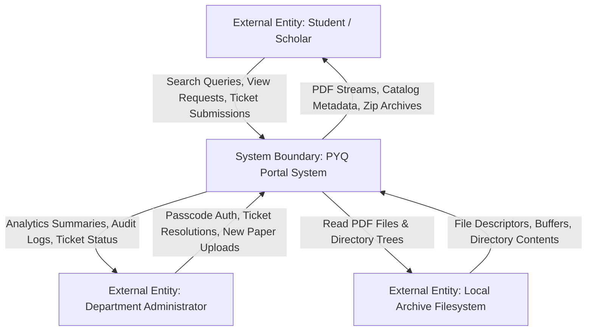
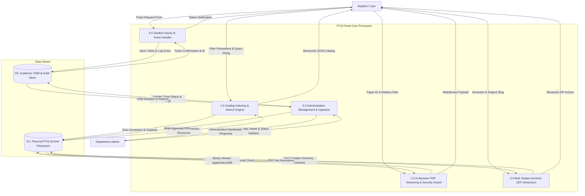
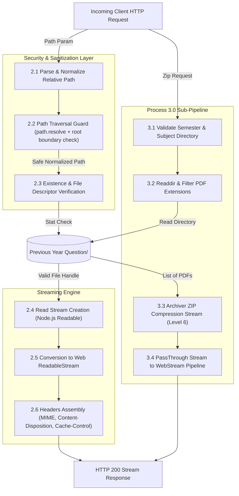

# PYQ Portal | University Previous Year Question Papers & Syllabi

[](https://nextjs.org/)
[](https://react.dev/)
[](https://www.typescriptlang.org/)
[](https://nodejs.org/)
[](https://www.npmjs.com/package/archiver)
[](https://lucide.dev/)

A clean, high-performance academic portal designed for university students and faculty to access, search, preview in-browser, and download digitized Previous Year Question (PYQ) examination papers and CBCS course syllabus insights across all academic semesters.

Developed by [Atul Sah](https://atulsah.in).

---

## Table of Contents

- [Overview](#overview)
- [Key Features](#key-features)
- [System Architecture](#system-architecture)
- [Data Flow Diagrams (DFD)](#data-flow-diagrams-dfd)
  - [Level 0: Context Diagram](#level-0-context-diagram)
  - [Level 1: System Decomposition](#level-1-system-decomposition)
  - [Level 2: PDF Stream and Archive Pipeline](#level-2-pdf-stream-and-archive-pipeline)
- [Technology Stack](#technology-stack)
- [Project Directory Structure](#project-directory-structure)
- [Installation and Setup](#installation-and-setup)
- [Available Scripts](#available-scripts)
- [Security and Path Validation](#security-and-path-validation)
- [Developer Attribution](#developer-attribution)

---

## Overview

University students often face difficulties finding authoritative, categorized previous year question papers before semester examinations. Physical records in university libraries are hard to locate and prone to damage, while informal student groups often circulate incomplete, unorganized scans.

**PYQ Portal** solves this problem by providing a centralized digital archive built on Next.js 15 (App Router) and React 19. It organizes papers systematically by academic semester (Semester 1st to Semester 6th), CBCS course categories (Core Course, Generic Elective, Skill Enhancement, Discipline Specific Elective), and examination years (2021 to 2026). Students can view PDF documents in an embedded, distraction-free modal viewer or download single papers and bulk ZIP archives on demand.

---

## Key Features

- **Semester-Wise Navigation**: Fast tab-based switching between Semester 1st through Semester 6th, displaying active paper counts and status.
- **Dynamic Course Categorization**: Automatic grouping into Core Courses (CC), Generic Electives (GE), Skill Enhancement Courses (SEC), and Discipline Specific Electives (DSE).
- **Instant Search and Filtering**: Multi-attribute search across course codes, titles, examination years, and syllabus topics.
- **In-Browser PDF Viewer**: Secure, high-resolution modal preview with full-screen toggle, pagination, and direct download links.
- **Bulk Download Engine**: Server-side dynamic streaming of subject-wide ZIP archives using `archiver` and Web Streams.
- **Syllabus and Exam Pattern Insights**: Curated academic overviews, high-weightage topics, and preparation advice for each subject.
- **Academic Ticket CRM**: Workflow for students to submit inquiries, report missing papers, or request syllabus clarifications.
- **Safe Path Sanitization**: Rigorous path-traversal prevention ensuring filesystem reads remain restricted to verified archive directories.

---

## System Architecture

The application is structured around Next.js App Router with server-side filesystem indexing and client-side interactive rendering:

```
[Browser Client]
       |
       v
[Next.js App Router (RSC + Client Components)]
       |
       +---> [Server Actions / API Handlers]
       |            |
       |            +---> [pyq-service.ts] (Catalog indexer, Path traversal guard)
       |            +---> [crm-service.ts] (Student tickets, Event logging)
       |
       v
[Filesystem Storage]
  |-- Previous Year Question/  (PDF Documents partitioned by Semester & Course)
  `-- data/                    (JSON ticket storage and audit logs)
```

---

## Data Flow Diagrams (DFD)

### Level 0: Context Diagram

The Level 0 context diagram displays the primary system boundary, external human entities, and high-level data exchanges.



---

### Level 1: System Decomposition

The Level 1 DFD decomposes the system boundary into its five major core processes, internal data stores, and verified data routes.



---

### Level 2: PDF Stream and Archive Pipeline

The Level 2 DFD decomposes Process 2.0 (PDF Streaming) and Process 3.0 (Bulk Archiving) to detail how path sanitization, security validation, and stream piping operate.



---

## Technology Stack

| Layer | Technology | Version | Purpose |
| :--- | :--- | :--- | :--- |
| **Framework** | Next.js (App Router) | `15.1.7` | Server-Side Rendering, API Routes, Optimization |
| **UI Library** | React | `19.0.0` | Declarative UI Components, Client States |
| **Language** | TypeScript | `5.7.3` | Type-safety, Interface Specifications |
| **Runtime** | Node.js | `>= 20.x` | Runtime Environment, Native Stream API |
| **Packaging** | Archiver | `7.0.1` | Dynamic On-the-Fly ZIP Archiving |
| **Styling** | Vanilla CSS (Design Tokens) | CSS3 | Responsive layouts, CSS Variables, Zero-bundle overhead |
| **Icons** | Lucide React | `0.475.0` | Accessible, Feather-derived SVG Icons |

---

## Project Directory Structure

```
pyq-portal/
|-- .gitignore                  # Git exclusion rules for node_modules, .next, etc.
|-- README.md                   # System documentation and DFDs
|-- pyq-portal-editing.md       # Persistent agent memory and audit history
|-- package.json                # Project dependencies and operational scripts
|-- tsconfig.json               # TypeScript compiler configuration
|-- next.config.mjs             # Next.js bundler and runtime settings
|
|-- app/                        # Next.js App Router
|   |-- layout.tsx              # Root HTML layout with Google Font configuration
|   |-- page.tsx                # Main entry point serving the PYQ Explorer
|   |-- globals.css             # Design tokens, typography, grid utilities
|   `-- api/                    # Serverless API routes
|       |-- pyq/
|       |   |-- catalog/        # Dynamic JSON catalog indexing endpoint
|       |   |-- download/       # Single PDF attachment download handler
|       |   |-- download-all/   # Dynamic ZIP generation endpoint
|       |   `-- view/           # Inline PDF stream for in-browser viewer
|       `-- crm/
|           |-- analytics/      # Administrative analytics and view counters
|           |-- auth/           # Administrative credential validator
|           |-- requests/       # Ticket creation, retrieval, and status updates
|           `-- upload/         # Departmental paper upload handler
|
|-- components/                 # React UI Components
|   |-- Navbar.tsx              # Application header with archive stats
|   |-- HeroHeader.tsx          # Institutional banner with key metrics
|   |-- SemesterTabs.tsx        # Navigation tabs for semesters 1 through 6
|   |-- SearchAndFilters.tsx    # Real-time search bar and category selector
|   |-- SubjectCard.tsx         # Subject cards with paper links and syllabus tips
|   |-- PdfViewerModal.tsx      # In-browser embedded PDF previewer
|   |-- EmptyState.tsx          # Fallback illustrations for empty filters
|   `-- PYQExplorer.tsx         # Root client controller and state orchestrator
|
|-- lib/                        # Core Domain Logic and Services
|   |-- pyq-service.ts          # Filesystem scanner, catalog cache, path guards
|   `-- crm-service.ts          # Ticket lifecycle, event logger, local store
|
`-- Previous Year Question/     # Physical Paper Repository (Semester 1st to 6th)
```

---

## Installation and Setup

### Prerequisites

- Node.js version `20.x` or higher
- npm (Node Package Manager) or yarn

### Setup Instructions

1. Clone or download the repository:
   ```bash
   git clone https://github.com/bcabnc/pyq-portal.git
   cd pyq-portal
   ```

2. Install project dependencies:
   ```bash
   npm install
   ```

3. Verify archive files:
   Ensure that the `Previous Year Question/` directory is present in the project root containing semester folders.

4. Start the development server:
   ```bash
   npm run dev
   ```

5. Access the application:
   Open [http://localhost:3000](http://localhost:3000) in your web browser.

---

## Available Scripts

- `npm run dev`: Starts the Next.js development server with hot-module replacement.
- `npm run build`: Compiles TypeScript, lints code, and generates an optimized production build.
- `npm run start`: Launches the compiled Next.js production server.
- `npm run lint`: Executes Next.js ESLint verification across source files.

---

## Security and Path Validation

To protect against path-traversal vulnerabilities (`../`), the application enforces strict boundaries on all filesystem requests:

1. **Path Resolution**: Relative paths provided by clients are normalized and resolved against `process.cwd()` using `path.resolve`.
2. **Boundary Enforcement**: Paths are checked with `.startsWith(rootDir + path.sep)` to ensure access cannot escape the designated root.
3. **MIME Verification**: Single-paper views and downloads strictly enforce `application/pdf`, while uploads require `.pdf` extensions.
4. **Credential Isolation**: Administrative authentication utilizes isolated environmental passcodes with no client exposure.

---

## Developer Attribution

Developed by [Atul Sah](https://atulsah.in).
